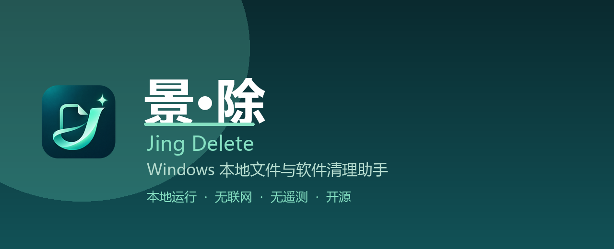
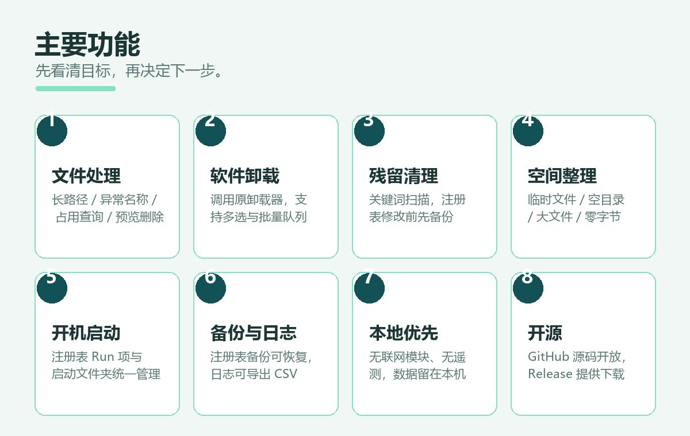

# 景·除 / Jing Delete



[](https://github.com/jingpanlong/JingDelete/releases)
[](https://github.com/jingpanlong/JingDelete/releases)
[](https://github.com/jingpanlong/JingDelete)
[](https://docs.microsoft.com/dotnet/framework/)
[](LICENSE)

**景·除（Jing Delete）** 是一款 Windows 本地文件与软件清理工具：文件删除、软件卸载、残留清理、空间整理与开机启动管理。一切操作都在本机完成，**无联网模块、无遥测**。危险操作（删除、清理、权限修改）均要求显式确认。

> 作者联系：微信公众号「景同志」，小红书「景同学」。软件「关于」页内置 GitHub 开源地址与下载入口。

---

## 快速下载

| 版本 | 说明 | 下载 |
| --- | --- | --- |
| 便携版（单文件） | `JingChu.exe`，解压即用，依赖系统 .NET Framework | [JingChu.exe](https://github.com/jingpanlong/JingDelete/releases/latest/download/JingChu.exe) |
| 安装版 | `JingChu-Setup.exe`，按当前用户安装，含开始菜单与卸载入口 | [JingChu-Setup.exe](https://github.com/jingpanlong/JingDelete/releases/latest/download/JingChu-Setup.exe) |

也可在 [Releases](https://github.com/jingpanlong/JingDelete/releases) 页面查看历史版本与校验信息。

> 程序未经数字签名，系统可能显示「未知发布者」。本版本不申请或伪造签名；如需验证，请比对发布页的 SHA-256。

---

## 主要功能



1. **文件处理** — 拖拽 / 选择 / 粘贴路径；长路径、异常末尾点空格名称、Unicode 名称处理；删除前预览、占用进程查询、同卷重命名移动。
2. **软件卸载** — 读取传统桌面软件卸载登记，调用软件原卸载器；支持 Ctrl / Shift 多选与批量队列，结束后统一列出注册表候选残留。
3. **残留清理** — 按关键词扫描 SOFTWARE 直接子键、卸载登记与常见目录第一层文件夹；结果初始不勾选，注册表修改前强制导出备份。
4. **空间整理** — 到期临时文件、空文件夹、大文件、零字节文件四种扫描；结果可导出 CSV。
5. **开机启动** — 注册表 Run 项与用户 / 公共启动文件夹统一管理，文件项目可备份后禁用与恢复。
6. **备份与日志** — 注册表修改前导出备份，备份可恢复与导入；每日日志、实时结果、今日日志可导出。
7. **本地优先** — 无联网、无遥测，备份与日志均保存在本机用户目录。
8. **开源** — 源码开放，欢迎提交 Issue 与 Pull Request。

---

## 目录

- [编译](#编译)
- [已实现功能](#已实现功能)
- [使用流程](#使用流程)
- [数据与运行要求](#数据与运行要求)
- [能力边界](#能力边界)
- [测试](#测试)
- [文件结构](#文件结构)
- [开源与贡献](#开源与贡献)
- [许可证](#许可证)

---

## 编译

Windows 10/11，.NET Framework 4.7.2 或更新版本。无需下载 NuGet 包或安装 .NET SDK。

在本目录运行 Windows PowerShell：

```powershell
powershell.exe -NoProfile -ExecutionPolicy Bypass -File .\build.ps1
```

输出：`bin\JingChu.exe`、`bin\JingChu-Setup.exe`。两个都是单文件；便携程序依赖系统 .NET Framework，不是包含整个运行时的原生 EXE。安装器嵌入编译后的程序，并将自身复制为卸载器。

编译使用 Windows Framework 目录中的 C# 编译器。存在 4.7.2 引用程序集时使用其中的 Microsoft.VisualBasic；否则尝试 Framework 目录中的相应程序集。`app.ico` 是随源码提供的程序图标；`create-icon.ps1` 可重新生成。

## 已实现功能

1. 多文件/文件夹拖拽；文件选择、文件夹选择、手动输入路径。
2. 目标列表、勾选处理、移出列表、逐项状态反馈。
3. 文件/目录/链接属性查看，递归统计文件数、目录数和大小。
4. 回收站删除；永久删除；Unicode、长路径、异常末尾点/空格名称处理。
5. 删除前清除只读/隐藏/系统属性；管理员可选逐对象取得所有权、授予当前用户权限。
6. 同卷重命名/移动，不覆盖已有目标。
7. 使用 Restart Manager 查询占用进程；请求正常关闭；经确认后结束非系统进程，并核验进程创建时间。
8. 管理员可将本地目标按子项到父目录的顺序加入 Windows 重启删除队列，不自动重启。
9. 桌面软件卸载登记扫描、名称/发布者搜索、运行登记的卸载器、打开安装目录。
10. 按关键词扫描软件候选残留：常用目录第一层文件夹、SOFTWARE 直接子键、卸载登记。
11. 残留初始不勾选，逐项确认清理；注册表修改前强制导出备份。
12. 32/64 位注册表视图备份及导入；备份列表和目录入口。
13. 当前用户/本机 Run 启动项列表，备份后禁用，使用备份恢复。
14. 每日日志、实时结果、日志目录、今日日志导出。
15. 后台执行、取消后续步骤、管理员重启、系统目录拦截。
16. 当前用户安装、开始菜单与可选桌面快捷方式、系统卸载入口、独立卸载器。
17. 八个中文页面、软件说明、隐私说明和作者联系方式（含 GitHub 开源地址）。

## 使用流程

**文件**：添加/拖拽 → 核对并勾选 → 优先回收站；特殊路径可选永久删除。永久删除及重启排程需输入 `DELETE`。权限修复默认为关闭，启用后可能改变原权限，工具不备份原 ACL。

**软件**：刷新软件列表 → 选择软件 → 运行卸载 → 完成后刷新 → 输入独有关键词扫描残留 → 核对每个候选项 → 勾选清理。删除卸载登记本身不会卸载软件，目录和注册表键可能被同厂商多个产品共用。

**启动项**：刷新 → 选中 → 禁用。备份包含整个 Run 键，恢复时会合并备份中的所有值，可能重新启用其他启动项。

## 数据与运行要求

- 备份：`%LOCALAPPDATA%\JingChu\Backups`。
- 日志：`%LOCALAPPDATA%\JingChu\Logs`。路径和软件名称可能出现在日志中。
- 默认安装：`%LOCALAPPDATA%\Programs\JingChu`；按当前用户安装。
- 卸载景·除保留备份和日志，不递归删除安装目录中的未知文件。
- 普通文件操作无需管理员；本机注册表、权限修复和重启后删除可能需要管理员授权。
- 管理员重启不保留当前列表；若输入的是另一管理员账户，HKCU、用户目录和备份位置也会切换到该账户。
- 以管理员权限运行时，Windows 可能阻止从普通权限资源管理器拖拽文件，请使用添加按钮或粘贴路径。
- 程序未经数字签名，系统可能显示未知发布者；本版本不申请或伪造签名。
- 作者联系方式按用户提供的名称展示，未附加未经核实的账号链接。

## 能力边界

不提供内核驱动，不绕过杀毒/反作弊自保护，不处理 Windows 内部目录、磁盘/共享根目录、用户根目录、程序和备份根目录等。WindowsApps 与 ProgramData\Microsoft 也被拦截。

目录联接点和符号链接不递归进入目标；权限修复也拒绝对链接执行 takeown。目录在操作过程中被其他程序恶意替换的竞争情况不属于本版本的防御边界；处理前应关闭相关软件。

回收站模式拒绝根目标为链接或长路径的项目。是否支持回收由 Windows 决定，系统对网络或特殊设备可能显示额外对话框；注意阅读，必要时取消。永久删除失败、取消或重启排程失败可能已处理部分子项；没有事务回滚。重启排程成功也不保证开机最终删除，不提供排程撤销。

软件扫描只读传统桌面软件卸载登记，不列出全部商店应用。残留是名称匹配候选项，不是全盘、全注册表扫描，也不是智能判断“无用键”。未实现驱动卸载、浏览器清理、重复文件清理、系统修复等未列明功能。

占用查询受 Restart Manager 能力和系统策略限制。文件/目录上没有查到进程并不等于没有占用。为保护系统，禁止强制结束 Windows 目录中的程序、系统会话和本程序。

## 测试

```powershell
powershell.exe -NoProfile -ExecutionPolicy Bypass -File .\test.ps1 -TestRoot D:\some-workspace\new-test-directory
```

测试根目录必须尚不存在。测试程序仅创建专用临时文件、专用 HKCU 测试键、测试卸载登记与测试快捷方式，不操作真实软件；注册表测试键在 finally 中清理。测试文件和备份留在指定目录供检查。Restart Manager 和注册表导出需要允许访问 Windows 相应服务/注册表；受限沙箱可能拒绝。

当前 123 项自动检查通过，新增按钮背景像素、图标提取、搜索和刷新检查，原有回归覆盖路径保护、Unicode/只读、长路径及异常名称、链接目标保留、取消、移动不覆盖、锁定文件错误及释放、占用进程识别、注册表备份删除恢复、架构视图、模拟卸载器调用、安装器解包/快捷方式/登记、卸载及退出后的自删除、保留未知文件、安装界面及八页渲染。尚未对真实第三方卸载、UAC、管理员 ACL 修复、真实重启排程、交互式回收站进行完整端到端测试。

## 文件结构

- `Core.cs`：Windows 原生 API、文件处理、注册表与软件管理。
- `Extras.cs`：空间扫描、候选项复核删除、启动文件夹备份恢复、CSV 和预览。
- `App.cs`：中文 WinForms 主界面。
- `Screens.cs`：首页、空间整理、启动管理、作者页面和预览窗口。
- `Design.cs`：统一配色、圆角卡片、按钮、图形导航和列表样式。
- `SoftwareIcons.cs`：软件图标路径解析、资源提取和缺失回退。
- `Setup.cs`：安装器与卸载器。
- `Tests.cs`：隔离功能测试及页面渲染。
- `build.ps1` / `test.ps1`：离线编译与测试脚本。
- `app.manifest` / `AssemblyInfo.cs` / `app.ico`：程序元数据。
- `Brand.png` / `BRAND.md`：透明 Logo 与图像生成提示词、资产说明。
- `screenshots/`：README 配图（横幅与功能图）。

源码中的 `AppDomain` 测试数据槽仅由测试入口设置，正常程序没有对应的命令行或环境变量入口。

## 开源与贡献

本仓库为 **景·除 / Jing Delete** 的开放源码：

- 仓库地址：<https://github.com/jingpanlong/JingDelete>
- 问题反馈与功能建议：<https://github.com/jingpanlong/JingDelete/issues>
- 发布与下载：<https://github.com/jingpanlong/JingDelete/releases>

欢迎提交 Pull Request。提交前请运行 `test.ps1`（见上文测试说明）确认回归通过。

## 许可证

本项目以 [MIT 许可证](LICENSE) 开源。 Logo 与品牌视觉（含 `Brand.png`、`app.ico`）以相同许可证授权，但本版本未进行商标检索或注册。
